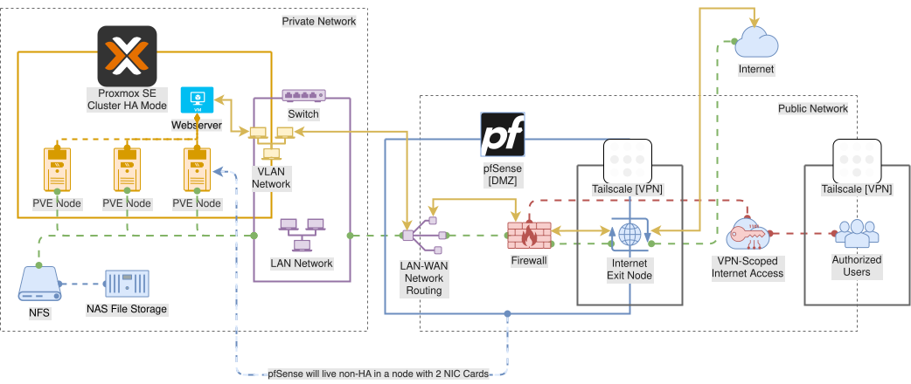

# papita-proxmox-lab

Hybrid **Proxmox VE** homelab: on-prem PVE nodes on **Tailscale** with an **OpenWrt** (or pfSense) LAN router advertising `172.16.0.0/16` to the tailnet. Bash deploy scripts orchestrate node bootstrap and cluster operations. **Cursor MCP servers** under [`mcp/`](./mcp/) expose Proxmox, pfSense, TrueNAS, and OpenWrt APIs to AI agents.

Network diagram source: [`docs/Diagrams.drawio`](./docs/Diagrams.drawio) (export to `docs/Diagrams-Network.png` for a static image).

---

## Overview

| Concern             | Where it lives                                                                                                                                              | What it does                                                                                              |
| ------------------- | ----------------------------------------------------------------------------------------------------------------------------------------------------------- | --------------------------------------------------------------------------------------------------------- |
| **Workstation CLI** | [`deploy/toolkit.sh`](./deploy/toolkit.sh)                                                                                                                  | Single entrypoint: Python dev tooling, Proxmox SSH deploy, optional AWS SSO/MFA                           |
| **PVE bootstrap**   | [`deploy/setup/setup-pve-node.sh`](./deploy/setup/setup-pve-node.sh)                                                                                        | Interactive **19-step** node setup (APT, WoL, sensors, hosts, Tailscale, hooks, QDevice, backups, TLS, node-exporter) |
| **Cluster ops**     | [`deploy/proxmox.sh`](./deploy/proxmox.sh)                                                                                                                  | SSH to nodes: `setup-node`, `setup-cluster-ha`, `setup-monitoring`, `get-temp`, `start-cluster`, `stop-cluster` |
| **Tailnet + LAN**   | [`deploy/tailscale-pfsense-lan.sh`](./deploy/tailscale-pfsense-lan.sh)                                                                                      | Approve router routes, patch Tailscale ACLs, verify admin path to main PVE                               |
| **pfSense pfREST**  | [`deploy/pfsense-restapi-access.sh`](./deploy/pfsense-restapi-access.sh) · [`deploy/pfsense-firewall-tailscale.sh`](./deploy/pfsense-firewall-tailscale.sh) | Bootstrap REST API access and apply agreed Tailscale-tab firewall rules via pfREST                        |
| **Monitoring**      | [`deploy/setup/misc/monitoring/`](./deploy/setup/misc/monitoring/)                                                                                          | Prometheus/Alertmanager on CT **231**; Grafana on QDevice Pi `172.16.0.99:3000`                          |
| **Cursor MCP**      | [`mcp/`](./mcp/) · [`deploy/mcp.sh`](./deploy/mcp.sh)                                                                                                       | Pre-install MCP packages, sync Cursor configs, install agent skills (user/project)                        |
| **Runbooks**        | [`docs/TIPSNTRICKS.md`](./docs/TIPSNTRICKS.md) · [`docs/ARCHITECTURE.md`](./docs/ARCHITECTURE.md)                                                            | Ceph, cluster, Tailscale, MCP smoke, HA/QDevice/NFS architecture                                          |

**Lab topology (default):**

- **LAN:** `172.16.0.0/16` (gateway `172.16.0.1` on OpenWrt; pfSense VM optional/legacy)
- **Main PVE admin node:** `172.16.0.101` (LAN + optional MagicDNS TLS on step 17)
- **Tailscale:** all PVE nodes join the tailnet for remote admin; **OpenWrt** (`openwrt-pi`) is the usual **subnet router** for LAN (pfSense remains supported); workers do not advertise routes
- **Remote admin:** reach Proxmox via LAN subnet route and/or main-node Tailscale TLS — not worker `:8006` on the tailnet
- **Observability:** Prometheus on CT `172.16.20.11:9090`; Grafana on QDevice Pi `172.16.0.99:3000` (not on CT 231)
- **AI agents (Cursor):** MCP over stdio to `proxmox-ve`, `pfsense`, `truenas`, and `openwrt` — run `./deploy/mcp.sh install` once so Cursor can spawn them; agents do not install packages at runtime

---

## Architecture

```text
                    ┌─────────────────────────────────────────┐
                    │  Workstation (this repo)                 │
                    │  deploy/toolkit.sh · deploy/mcp.sh       │
                    │  Cursor ──► proxmox-ve / pfsense / truenas / openwrt MCP │
                    └───────┬─────────────────────────────┘
                            │
              deploy/proxmox.sh
                            │
                            ▼
              ┌─────────────────────┐
              │  PVE cluster (on-prem)│
              │  • setup-pve-node.sh  │
              │  • Tailscale client   │
              │  • corosync / Ceph    │
              └──────────┬────────────┘
                         │
              ┌──────────▼────────────┐
              │  pfSense (Tailscale     │
              │  subnet router)         │
              │  advertises 172.16.0.0/16│
              │  pfREST :443 (MCP)      │
              └─────────────────────────┘
                         ▲
              deploy/tailscale-pfsense-lan.sh
              deploy/pfsense-* (pfREST bootstrap)
              (ACL + route approval from workstation)
```

**Data flow:** Management traffic between PVE nodes uses the **LAN / corosync** network. Operators use the **main node** for UI and toolkit commands over LAN or tailnet paths documented in TIPSNTRICKS §9. **MCP servers** use the same paths with API tokens (Proxmox) or pfREST API keys (pfSense) — no SSH shell for agent reads.



---

## Repository layout

```text
papita-proxmox-lab/
├── deploy/                         # Orchestration + PVE bundles (run from repo root)
│   ├── toolkit.sh                  # Main CLI
│   ├── proxmox.sh                  # SSH → PVE nodes
│   ├── mcp.sh                      # Install/update MCP pkgs + sync user/project mcp.json
│   ├── tailscale-pfsense-lan.sh    # Tailscale API + pfSense LAN helper
│   ├── pfsense-restapi-access.sh   # pfREST Allowed Interfaces bootstrap
│   ├── pfsense-firewall-tailscale.sh # Tailscale-tab firewall rules via pfREST
│   ├── utils.sh / usage.sh         # Shared logging, prompts, help text
│   ├── setup/                      # Copied to /root/deploy on each PVE node
│   │   ├── setup-pve-node.sh       # 19-step interactive bootstrap
│   │   ├── apt-dependencies.list   # Step 1 packages (includes gnupg for Tailscale apt)
│   │   ├── post-startup-proc.sh / pre-shutdown-proc.sh
│   │   ├── misc/tailscale/         # default tags, routes, LAN fallback lists
│   │   ├── misc/cluster/           # QDevice + TrueNAS NFS + HA helpers
│   │   └── misc/monitoring/        # Prometheus (CT 231) + Grafana (QDevice Pi) + Kuma
│   ├── python/                     # Copied to /root/deploy/python on nodes
│   │   ├── misc/cluster/           # discover_hosts.py, domain_pattern.py (step 7)
│   │   └── datafiles/              # default.hosts.*, domain suffix lists
│   └── docs/                       # Usage manuals (less during setup prompts)
│       ├── setup-pve-node.usage.txt
│       └── tailscale-pfsense-lan.usage.txt
├── mcp/                            # Cursor MCP servers (Poetry path deps)
│   ├── README.md                   # Install guide (scope, update, smoke)
│   ├── proxmox-ve-mcp/             # Proxmox VE REST — 21 tools (read + gated write)
│   ├── pfsense-mcp/                # pfSense pfREST — 7 read-only tools + policy framework
│   ├── truenas-mcp/                # TrueNAS WebSocket — storage health + gated writes
│   └── openwrt-mcp/                # OpenWrt firewall plan/approve/apply + watchdog
├── docs/
│   ├── TIPSNTRICKS.md              # Operational runbooks
│   ├── ARCHITECTURE.md             # Cluster / HA / NFS end-state
│   └── Diagrams.drawio
├── pyproject.toml                  # Poetry workspace (MCP path deps + linters + security floors)
├── poetry.lock                     # Tracked — Dependabot / reproducible installs
└── .pre-commit-config.yaml
```

**Not in git (local / secrets):** `.env`, `~/.cursor/mcp.json` (with real tokens), `.venv/`.

---

## Installation

### Workstation prerequisites

| Tool                            | Used for                                                                    |
| ------------------------------- | --------------------------------------------------------------------------- |
| **bash** 4+                     | All deploy scripts (`set -euo pipefail`)                                    |
| **Poetry** 2.x                  | Dev venv, MCP packages, linter tooling                                      |
| **Python** 3.11+                | MCP servers and pre-commit (3.14 in [`.python-version`](./.python-version)) |
| **jq**                          | Proxmox JSON (`pvesh`, cluster discovery, `mcp.json` merge)                 |
| **ssh**, **scp**                | `deploy/proxmox.sh`                                                         |
| **pre-commit** (optional)       | `./deploy/toolkit.sh … --pre-commit` or local hooks                         |
| **Cursor** (optional)           | MCP client for `proxmox-ve`, `pfsense`, and `truenas` servers                |

### Clone and Python dev environment

```bash
git clone <repo-url> papita-proxmox-lab
cd papita-proxmox-lab

# In-project venv at .venv/ (includes mcp/* path dependencies)
poetry install --with pre-commit --with test
poetry run pre-commit install   # optional: git hooks
```

VS Code / Cursor: [`.vscode/settings.json`](./.vscode/settings.json) points the Python extension at `.venv` and adds `deploy/python` to analysis paths.

### MCP servers (Cursor)

`deploy/mcp.sh` **prepares** the Poetry venv, Cursor `mcp.json` configs, and agent **skills** (under `.cursor/skills/`) ahead of time. Cursor then launches each server with `poetry run …` from the repo root — agents do **not** install MCP packages at runtime; they use the bundled skills to know when to call each MCP.

```bash
chmod +x deploy/mcp.sh   # once
./deploy/mcp.sh install                 # venv + sync mcp.json + install skills (both scopes)
# Or: --scope user | --scope project | --no-sync | --no-skills
./deploy/install-git-hooks.sh           # optional: auto-sync on git pull + agent session start
# Edit ~/.cursor/mcp.json → set API secrets (project config is seeded from user on first sync)
./deploy/mcp.sh smoke --server proxmox-ve-mcp
./deploy/mcp.sh smoke --server pfsense-mcp
./deploy/mcp.sh smoke --server truenas-mcp
```

After `git pull` when MCP code or skills changed: `./deploy/mcp.sh update`. Reload **Cursor** after install/sync. Full guide: [`mcp/README.md`](./mcp/README.md).

### PVE node prerequisites

Nodes are prepared by **`setup-node`** (or run [`deploy/setup/setup-pve-node.sh`](./deploy/setup/setup-pve-node.sh) locally on the node). Step 1 installs packages from [`deploy/setup/apt-dependencies.list`](./deploy/setup/apt-dependencies.list) (`jq`, `gnupg`, `lm-sensors`, `chrony`, `smartmontools`, `postfix`, `python3`, `corosync-qdevice`, …). `gnupg` is required for the signed Tailscale apt repo in step 8.

---

## Configuration

### Environment file (Tailscale + lab LAN)

Copy [`.env.example`](./.env.example) to `.env` (gitignored):

```bash
cp .env.example .env
# Edit: TAILSCALE_API_KEY, TAILSCALE_TAILNET, LAN_CIDR, MAIN_PVE_LAN_IP, …
```

Used by `deploy/tailscale-pfsense-lan.sh` and as optional **Tailscale Admin API** fallback for pfSense MCP smoke (`tailscale_subnet_route` check). Load via toolkit:

```bash
./deploy/toolkit.sh proxmox -e dev --env-file .env -ip 172.16.0.101 -pa setup-node
```

### Cursor MCP (`mcp.json`)

`install` / `update` (default `--scope both`) and `cursor-sync` merge each package's `mcp.json.example` into Cursor configs while **preserving existing `env` secrets**:

| Scope | Path | Used by |
| ----- | ---- | ------- |
| `user` | `~/.cursor/mcp.json` | Cursor IDE + cursor-agent (user-wide) |
| `project` | `.cursor/mcp.json` | This workspace |
| `both` | both (default for install/update) | Recommended |

Run `./deploy/install-git-hooks.sh` once to keep both configs updated after `git pull` and on each agent session. Set **`cwd`** to the **repo root** so Poetry reuses `.venv/`.

| Server id    | Package          | Key variables                                                                         |
| ------------ | ---------------- | ------------------------------------------------------------------------------------- |
| `proxmox-ve` | `proxmox-ve-mcp` | `PVE_HOST`, `PVE_API_TOKEN` or split `PVE_USER` / `PVE_TOKEN_ID` / `PVE_TOKEN_SECRET` |
| `pfsense`    | `pfsense-mcp`    | `PFSENSE_HOST` (IPv4/IPv6 only), `PFSENSE_API_KEY`, optional `PFSENSE_LOG_LEVEL`      |
| `truenas`    | `truenas-mcp`    | `TRUENAS_HOST`, `TRUENAS_API_KEY`; `TRUENAS_VERIFY_SSL` defaults **true** (set `false` only for self-signed lab certs) |
| `openwrt`    | `openwrt-mcp`    | See [`mcp/openwrt-mcp/`](./mcp/openwrt-mcp/) — plan/approve/apply with watchdog                                  |

Setup guides: [proxmox-ve-mcp/docs/PVE_TOKEN_SETUP.md](./mcp/proxmox-ve-mcp/docs/PVE_TOKEN_SETUP.md), [pfsense-mcp/docs/PFSENSE_API_KEY_SETUP.md](./mcp/pfsense-mcp/docs/PFSENSE_API_KEY_SETUP.md), [truenas-mcp/docs/API_KEY_SETUP.md](./mcp/truenas-mcp/docs/API_KEY_SETUP.md), [openwrt-mcp/README.md](./mcp/openwrt-mcp/README.md).

### SSH to PVE

- **User:** `root` (default)
- **Auth:** SSH keys preferred (`--identity-file` / `-if`, or env `PAPITA_SSH_IDENTITY_FILE`); optional `PAPITA_SSH_PASSWORD` or `SSH_CLUSTER_PASSWORD` for scripted peer access (`get-temp`, etc.)
- **Remote bundle path:** `/root/deploy` (contents of `deploy/setup/`, `deploy/python/`, plus copied `utils.sh`, `usage.sh`, `docs/setup-pve-node.usage.txt`)

---

## Usage

All deploy commands assume the **repository root** as the current working directory.

### Toolkit (main entrypoint)

```bash
./deploy/toolkit.sh ACTION -e {dev|prod} [OPTIONS]
```

| Action                       | Description                                               |
| ---------------------------- | --------------------------------------------------------- |
| `build`                      | Build wheels from `libs/` → `dist/` (when `libs/` exists) |
| `devsync`                    | `build` + pip install wheels into the active env          |
| `test`                       | `build` + pytest with coverage (when `tests/` exists)     |
| `proxmox` / `deploy_proxmox` | Delegate to [`deploy/proxmox.sh`](./deploy/proxmox.sh)    |
| `none`                       | No-op; useful with `--pre-commit` only                    |

Common flags: `--env-file`, `--aws-sso` / `--aws-mfa`, `--pre-commit`, `--proxmox-action`, `--ip-address`, `--hostname`, `--profile`, `--region`.

```bash
# Full help
./deploy/toolkit.sh -h

# Bootstrap a node (interactive TTY over SSH)
./deploy/toolkit.sh proxmox -e dev -ip 172.16.0.102 -pa setup-node

# Cluster temperatures (requires lm-sensors / step 5 on nodes)
./deploy/toolkit.sh proxmox -e dev -ip 172.16.0.101 -pa get-temp
```

### MCP servers (`deploy/mcp.sh`)

Prepares the repo Poetry venv, Cursor launch configs, and agent skills that teach when to invoke each MCP. Cursor spawns servers at session time; it does not re-run install.

| Action        | Description                                                                                          |
| ------------- | ---------------------------------------------------------------------------------------------------- |
| `list`        | Show packages under `mcp/`, Cursor server ids, and bundled skills                                    |
| `install`     | Poetry install + register console scripts; sync mcp.json; install skills for `--scope` (default `both`) |
| `update`      | Re-lock/reinstall + refresh mcp.json + skills for `--scope` — run after `git pull`                   |
| `test`        | `pytest` for all MCP test suites                                                                     |
| `smoke`       | Live connectivity smoke (loads credentials from `~/.cursor/mcp.json`)                                |
| `cursor-sync` | Merge `mcp.json.example` into user and/or project mcp.json (keeps existing secrets)                  |
| `skills-sync` | Copy/refresh bundled skills for `--scope` (no Poetry)                                                |

Bundled skills (source `.cursor/skills/`): `papita-proxmox-lab-map`, `proxmox-ve-mcp`, `truenas-mcp`. With `--scope user` or `both`, copies land in `~/.cursor/skills/` (repo-relative links rewritten to absolute paths).

Options: `--scope user|project|both`, `--no-sync`, `--no-skills`, `--server NAME`, `--all-targets` (alias for `--scope both`).

```bash
./deploy/mcp.sh install                                    # venv + mcp.json + skills (both)
./deploy/mcp.sh install --scope user                       # user mcp.json + ~/.cursor/skills
./deploy/mcp.sh update                                     # after git pull
./deploy/mcp.sh skills-sync --scope both                   # skills only
./deploy/mcp.sh smoke --server proxmox-ve-mcp              # 6 basic checks
./deploy/mcp.sh smoke --server proxmox-ve-mcp --extended   # extended checks (guests, storage, HA, power permissions)
./deploy/mcp.sh smoke --server pfsense-mcp                 # 9 checks (core + lab policy)
./deploy/mcp.sh smoke --server truenas-mcp
```

| Package            | Tools | Console scripts (examples)                                                          |
| ------------------ | ----- | ----------------------------------------------------------------------------------- |
| **proxmox-ve-mcp** | 21    | `proxmox-ve-mcp`, `proxmox-ve-mcp-smoke`                                            |
| **pfsense-mcp**    | 7     | `pfsense-mcp`, `pfsense-mcp-smoke`, `pfsense-mcp-bootstrap`, `pfsense-mcp-firewall` |
| **truenas-mcp**    | —     | `truenas-mcp`, `truenas-mcp-smoke`                                                  |

In Cursor, call **`pve_run_smoke_tests`** or **`pfs_run_smoke_tests`** after install. Package READMEs: [`mcp/proxmox-ve-mcp/README.md`](./mcp/proxmox-ve-mcp/README.md), [`mcp/pfsense-mcp/README.md`](./mcp/pfsense-mcp/README.md), [`mcp/truenas-mcp/README.md`](./mcp/truenas-mcp/README.md).

### pfSense pfREST helpers

These scripts load `PFSENSE_*` from `~/.cursor/mcp.json` (via `cursor-sync`):

```bash
./deploy/pfsense-restapi-access.sh fix-access    # clear Allowed Interfaces (Tailscale path)
./deploy/pfsense-restapi-access.sh probe-version # connectivity check
./deploy/pfsense-firewall-tailscale.sh apply     # Tailscale-tab AUTH_CLIENTS rules + smoke
./deploy/pfsense-firewall-tailscale.sh apply --dry-run
```

Policy reference: [pfsense-mcp/docs/POLICY.md](./mcp/pfsense-mcp/docs/POLICY.md). WebGUI checklist: `./deploy/tailscale-pfsense-lan.sh pfsense-steps`.

### Proxmox (`deploy/proxmox.sh`)

| Action                         | Purpose                                                |
| ------------------------------ | ------------------------------------------------------ |
| `setup-node`                   | Replace remote `/root/deploy`, run `setup-pve-node.sh` |
| `setup-cluster-ha`             | QDevice + TrueNAS NFS + HA group (see TIPSNTRICKS)     |
| `setup-monitoring`             | Deploy `misc/monitoring` to CT 231 + node-exporter on members |
| `get-temp`                     | Cluster-wide `sensors -j` table                        |
| `start-cluster`                | WoL **offline** peers via `pvenode wakeonlan` (online-only lists skip sleeping nodes) |
| `stop-cluster`                 | `pvesh stopall` + shutdown per node                    |
| `cluster-nodes` / `local-node` | Discovery helpers                                      |

```bash
./deploy/proxmox.sh setup-node --ip-address 172.16.0.101
./deploy/proxmox.sh get-temp --ip-address 172.16.0.101
./deploy/proxmox.sh start-cluster --ip-address 172.16.0.101
```

Manual for setup prompts: [`deploy/docs/setup-pve-node.usage.txt`](./deploy/docs/setup-pve-node.usage.txt).

### PVE setup steps (`setup-pve-node.sh`)

Controlled by `PVE_SETUP_LAST_STEP=19`. At the first prompt, enter `y`, `n`, a step number `1`–`19`, or `h`/`help` for the full manual.

| Step | Topic                                                                         |
| ---- | ----------------------------------------------------------------------------- |
| 1    | APT, dependencies (incl. `gnupg`), unattended-upgrades, upgrade cron, optional microcode |
| 2    | Hibernate / sleep off (WoL-friendly poweroff)                                 |
| 3    | Wake-on-LAN                                                                   |
| 4    | Locales                                                                       |
| 5    | lm-sensors (enables `get-temp`)                                               |
| 6    | chrony NTP                                                                    |
| 7    | `/etc/hosts` cluster peers via DNS (`discover_hosts.py`) — **before `pvecm`** |
| 8    | Tailscale via **signed pkgs.tailscale.com apt** (GPG fingerprint + `signed-by`), sysctl, optional `cluster.fw` / NAT |
| 9    | `tailscale up` (main vs worker route policy)                                  |
| 10   | Post-startup systemd (quorum wait, Ceph noout unset, main-node WoL)           |
| 11   | Pre-shutdown systemd (optional `pvesh stopall`, Ceph noout)                   |
| 12   | Email (postfix + Proxmox mailto)                                              |
| 13   | SMART monitoring cron                                                         |
| 14   | Enable Proxmox cluster firewall                                               |
| 15   | Remove PVE subscription nag                                                   |
| 16   | vzdump backup cron                                                            |
| 17   | Tailscale TLS cert for UI `:8006` (**main node only**)                        |
| 18   | QDevice client (`corosync-qdevice`) + softdog watchdog (HA fencing prep)      |
| 19   | prometheus-node-exporter `:9100` (scraped by Prometheus on CT 231)            |

After all nodes complete step 18, run **`./deploy/proxmox.sh setup-cluster-ha --ip-address 172.16.0.101`**. Push Prometheus/Alertmanager (CT 231) + node-exporter with **`./deploy/proxmox.sh setup-monitoring --ip-address 172.16.0.101`**. Install Grafana on the QDevice Pi separately — see [`deploy/setup/misc/monitoring/README.md`](./deploy/setup/misc/monitoring/README.md).

### Tailscale + lab LAN router

The LAN gateway is **OpenWrt** `openwrt-pi` (`100.78.68.87`, advertises `172.16.0.0/16`). pfSense (`pfsense-fw001`) is the previous router; `configure` still matches either hostname (`LAN_ROUTER_NAME` then `PFSENSE_NAME`).

```bash
ssh -i ~/.ssh/id_ed25519_NASGW root@100.78.68.87
export TAILSCALE_API_KEY='tskey-api-...'
export TAILSCALE_TAILNET='your-tailnet.ts.net'
./deploy/tailscale-pfsense-lan.sh configure          # routes + ACL + verify
./deploy/tailscale-pfsense-lan.sh verify             # local checks only
./deploy/tailscale-pfsense-lan.sh pfsense-steps      # pfSense WebGUI checklist (legacy)
```

Actions: `configure`, `approve-routes`, `patch-acl`, `verify`, `pfsense-steps`. Manual: [`deploy/docs/tailscale-pfsense-lan.usage.txt`](./deploy/docs/tailscale-pfsense-lan.usage.txt).

---

## Python tooling

| Component                                                                                        | Role                                                   |
| ------------------------------------------------------------------------------------------------ | ------------------------------------------------------ |
| [`mcp/proxmox-ve-mcp/`](./mcp/proxmox-ve-mcp/)                                                   | Proxmox VE MCP server (FastMCP, httpx, Pydantic)       |
| [`mcp/pfsense-mcp/`](./mcp/pfsense-mcp/)                                                         | pfSense pfREST MCP server + lab policy framework       |
| [`mcp/truenas-mcp/`](./mcp/truenas-mcp/)                                                         | TrueNAS WebSocket MCP server (storage, Scrutiny, writes) |
| [`deploy/python/misc/cluster/discover_hosts.py`](./deploy/python/misc/cluster/discover_hosts.py) | Step 7: DNS peer discovery → `/etc/hosts` lines        |
| [`deploy/python/misc/cluster/domain_pattern.py`](./deploy/python/misc/cluster/domain_pattern.py) | Wildcard domain suffix expansion (`oldtimers.*`, etc.) |
| [`deploy/python/datafiles/`](./deploy/python/datafiles/)                                         | Default host lists, regex, domain suffix labels        |

On PVE nodes, Python is **runtime-only** (no Poetry). On the workstation, Poetry manages MCP packages as **path dependencies** and dev linters (black, isort, flake8, pylint, mypy, interrogate) via [`pyproject.toml`](./pyproject.toml) and [`.pre-commit-config.yaml`](./.pre-commit-config.yaml).

```bash
poetry run pre-commit run --all-files
poetry run pytest mcp/proxmox-ve-mcp/tests/ mcp/pfsense-mcp/tests/ mcp/truenas-mcp/tests/
./deploy/mcp.sh test
# or
./deploy/toolkit.sh none -e dev --pre-commit
```

MCP packages emit **structured JSON logs on stderr** (`PVE_LOG_LEVEL` / `PFSENSE_LOG_LEVEL` / TrueNAS equivalents); stdout stays free for MCP stdio protocol traffic.

---

## Development

| Task                    | Command                                                                                                                                          |
| ----------------------- | ------------------------------------------------------------------------------------------------------------------------------------------------ |
| Install dev deps        | `poetry install --with pre-commit --with test`                                                                                                   |
| Run linters             | `poetry run pre-commit run --all-files`                                                                                                          |
| MCP unit tests          | `./deploy/mcp.sh test` or `poetry run pytest mcp/*/tests/`                                                                                       |
| MCP live smoke          | `./deploy/mcp.sh smoke --server proxmox-ve-mcp` / `pfsense-mcp`                                                                                  |
| Shell conventions       | `set -euo pipefail`; source `deploy/utils.sh` + `deploy/usage.sh` before `log`                                                                   |
| Adding a PVE setup step | Bump `PVE_SETUP_LAST_STEP`, add `_skip_pve_step`, update menu + [`deploy/docs/setup-pve-node.usage.txt`](./deploy/docs/setup-pve-node.usage.txt) |
| Adding an MCP package   | Create `mcp/<name>-mcp/`, add path dep to root `pyproject.toml`, document in [`mcp/README.md`](./mcp/README.md)                                  |

**Secrets:** never commit `.env`, API tokens, Tailscale keys, or `~/.cursor/mcp.json` with real credentials (see [`.gitignore`](./.gitignore)).

---

## Documentation index

| Document                                                                        | Contents                                                                      |
| ------------------------------------------------------------------------------- | ----------------------------------------------------------------------------- |
| [**Architecture**](./docs/ARCHITECTURE.md)                                      | Cluster / HA / QDevice / TrueNAS NFS end-state                                |
| [**MCP install guide**](./mcp/README.md)                                        | `deploy/mcp.sh` install/update, `--scope`, Cursor sync, smoke                 |
| [**Proxmox VE MCP**](./mcp/proxmox-ve-mcp/README.md)                            | 21 tools, token setup, smoke catalog, requirements                            |
| [**pfSense MCP**](./mcp/pfsense-mcp/README.md)                                  | 7 read tools, pfREST setup, policy framework                                  |
| [**TrueNAS MCP**](./mcp/truenas-mcp/README.md)                                  | WebSocket API, storage health, gated writes; `TRUENAS_VERIFY_SSL` default true |
| [**OpenWrt MCP**](./mcp/openwrt-mcp/README.md)                                  | Firewall plan → approve → apply + watchdog                                    |
| [**pfSense lab policy**](./mcp/pfsense-mcp/docs/POLICY.md)                      | Tailscale firewall, REST API access, endpoint privilege domains               |
| [**Lab monitoring**](./deploy/setup/misc/monitoring/README.md)                  | Prometheus CT 231, Grafana on QDevice Pi, Uptime Kuma                         |
| [**Proxmox Tips & Tricks**](./docs/TIPSNTRICKS.md)                              | Ceph, cluster, Tailscale/OpenWrt, TrueNAS, MCP, maintenance                   |
| [**PVE setup manual**](./deploy/docs/setup-pve-node.usage.txt)                  | Full 19-step reference (shown in `less` during setup)                         |
| [**Tailscale / LAN router manual**](./deploy/docs/tailscale-pfsense-lan.usage.txt) | ACL grants, verify, OpenWrt/pfSense checklist                              |
| [**Network diagram**](./docs/Diagrams.drawio)                                   | Editable architecture (draw.io)                                               |

---

## Project status

| Area                                 | State                                                           |
| ------------------------------------ | --------------------------------------------------------------- |
| PVE bootstrap + cluster scripts      | Active (`setup-pve-node.sh`, `proxmox.sh` — 19 steps)           |
| Monitoring stack                     | Active (Prometheus/Alertmanager CT 231; Grafana on QDevice Pi)  |
| Tailscale / LAN router automation    | Active (`tailscale-pfsense-lan.sh`; OpenWrt primary, pfSense helpers) |
| **Cursor MCP — Proxmox VE**          | Active (`proxmox-ve-mcp` — read + gated write)                  |
| **Cursor MCP — pfSense**             | Active (`pfsense-mcp` — read-only + lab policy verify)          |
| **Cursor MCP — TrueNAS**             | Active (`truenas-mcp` — storage health + gated writes)          |
| **Cursor MCP — OpenWrt**             | Active (`openwrt-mcp` — plan/approve/apply + watchdog)          |
| `poetry.lock`                        | Tracked (Dependabot / reproducible installs)                    |
| Legacy Python app packages (`libs/`) | Referenced by toolkit; not in repository                        |

---

## License

See [LICENSE](./LICENSE).
